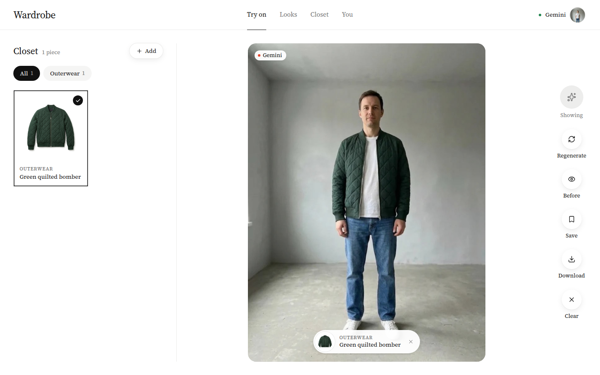
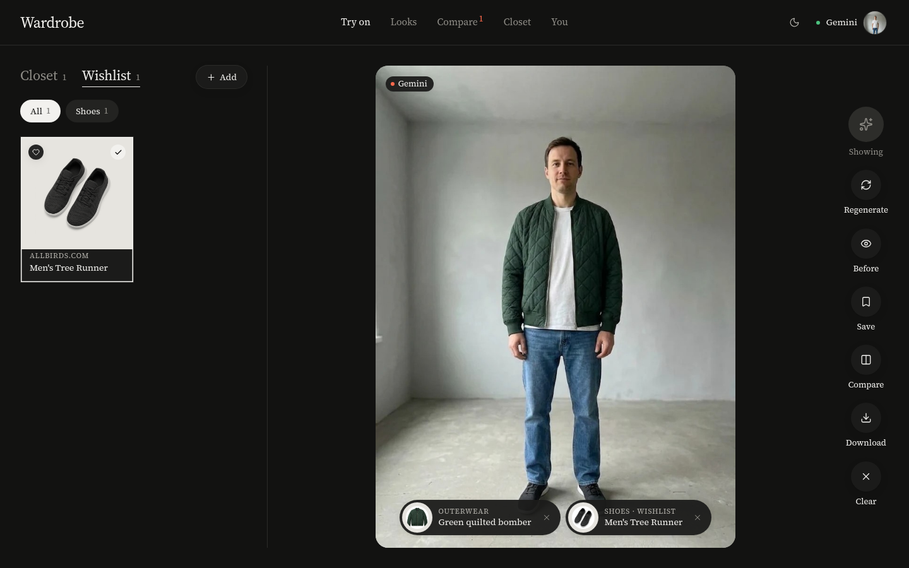
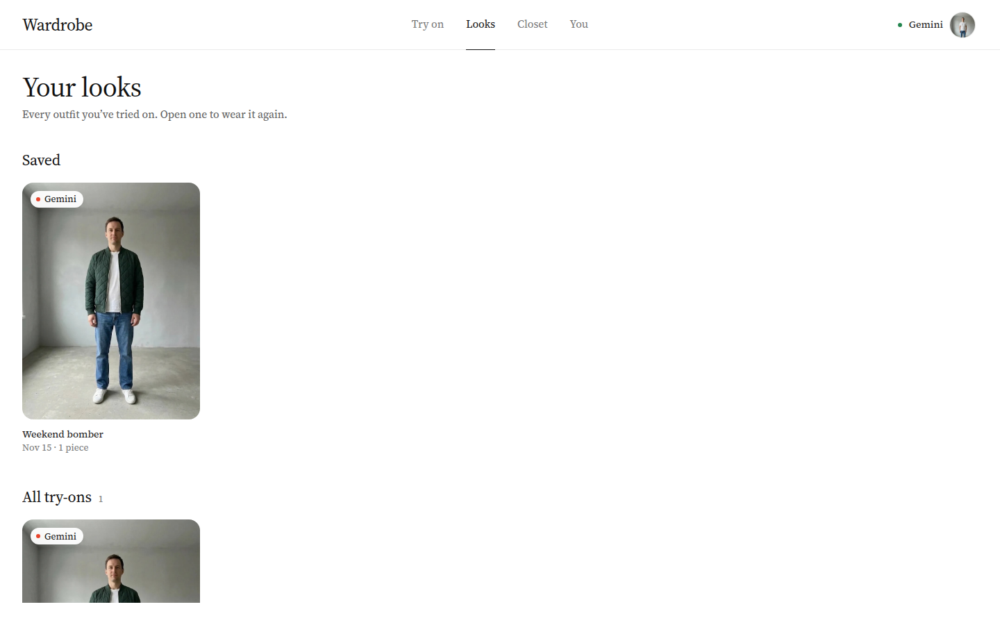
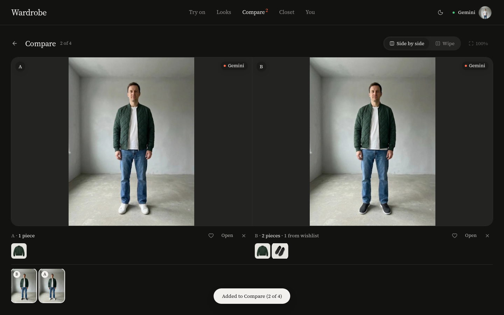
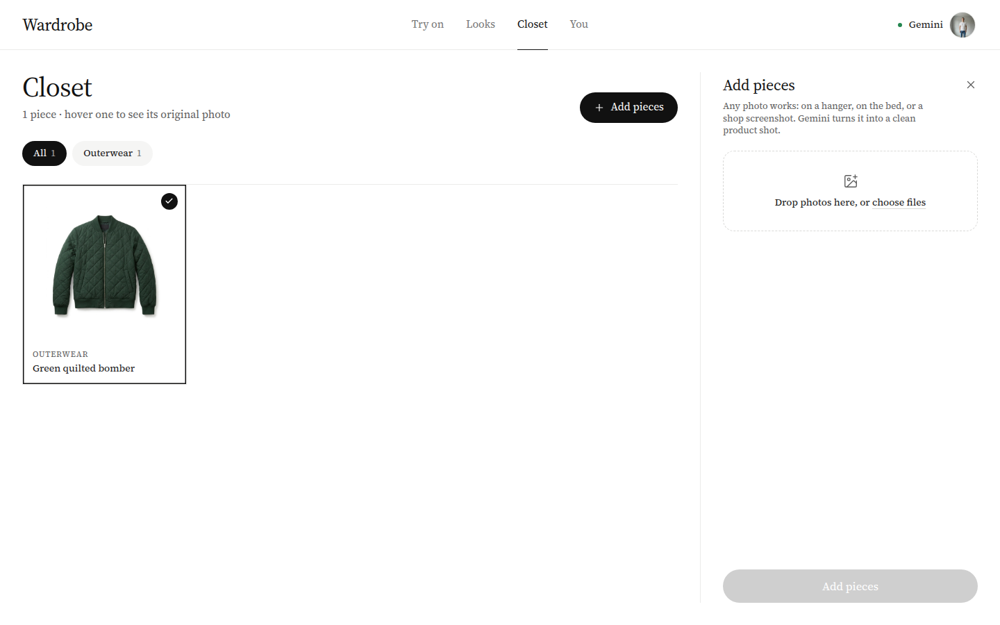
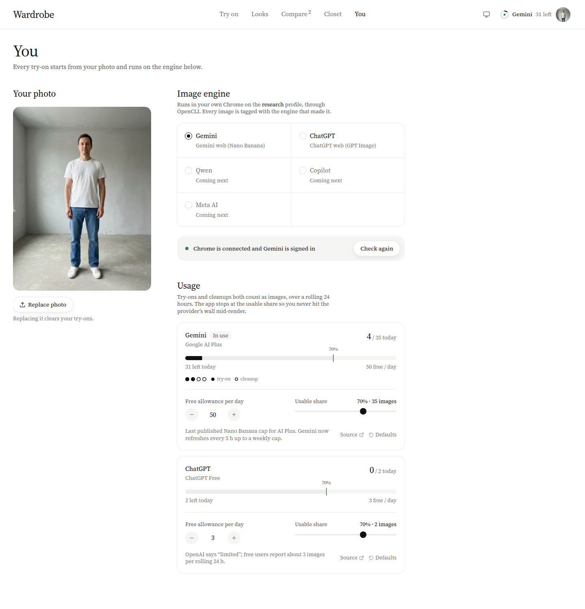

# Wardrobe

**See clothes on you before you wear them, or before you buy them.**

Add one full-body photo of yourself and photos of your clothes, and Wardrobe shows you wearing them. Paste a link
from an online shop to try something on before you buy it. Everything runs on your own computer, and the pictures
are made with your own Google Gemini account. No sign-up, no subscription, no API keys.

## What you can do

- **Try things on.** Pick a top, trousers, a jacket, shoes, and see the whole outfit on you.
- **Try before you buy.** Paste a shop link; Wardrobe grabs the product photo and puts it on you.
- **Build on a look.** Every try-on is saved as a version, so you can add one more piece or go back a step.
- **Compare.** Put two looks side by side, or drag a slider between them.
- **Ask the Stylist.** Get outfit ideas with links to shops, from Meta AI.
- **Several photos.** Keep up to 12 photos of yourself (different poses or outfits), each with its own try-ons.
- **Pick your AI.** Gemini by default; ChatGPT and Qwen work too if you're signed in to them.
- **Keep a closet.** Your clothes get clean, background-free photos, sorted into tops, bottoms, shoes and more.
- **Stay within your limits.** A small meter shows how many images you have left today.

## A quick look

*(Shown with a stand-in photo and sample clothes.)*

**Try on.** Pick pieces from your closet and see the outfit on you.



**Try before you buy.** Paste a shop link and the product joins your Wishlist, ready to try on.



**Looks.** Every try-on is kept, and the ones you save are pinned at the top.



**Compare.** Two looks side by side, or drag a slider between them.



**Closet.** Add photos of your clothes; they become clean product shots.



**You.** Your photo, your image engine, and a meter for how many images you have left today.



## Install (about 2 minutes)

You need a **Mac** or a **Windows 10/11 PC**, **[Google Chrome](https://www.google.com/chrome/)**, and a
**Google account** (a free one works).

**On a Mac:** open **Terminal** (press ⌘ Space, type *Terminal*, press Enter), paste this line and press Enter:

```bash
curl -fsSL https://github.com/sushi057/wardrobe/releases/latest/download/install.sh | sh
```

**On Windows:** open **PowerShell** (Start menu, type *PowerShell*, press Enter), paste this line and press Enter:

```powershell
irm https://github.com/sushi057/wardrobe/releases/latest/download/install.ps1 | iex
```

Wardrobe opens in Chrome and walks you through two quick steps:

1. **Add OpenCLI to Chrome.** A free extension that lets Wardrobe use Gemini in your browser. One click on
   *Add to Chrome*.
2. **Sign in to Gemini** with your Google account.

That's it. Upload your photo and start trying things on.

**Next time:** open **Wardrobe** from Applications (Mac) or from the shortcut on your Desktop / Start menu (Windows).
**To update:** paste the same line again. Your photos and closet are kept.

## Good to know

- **Your photos stay on your computer.** They're only sent to Gemini, in your own account, to make the try-on images.
  Wardrobe has no server of its own.
- **Chrome jumps to a Gemini window for a few seconds** while a try-on starts, then hands you back. Leave Chrome open
  while Wardrobe works.
- **Daily limits come from Google.** Free Gemini accounts make fewer images a day than paid ones. Wardrobe assumes the
  free plan; if you pay for Gemini, raise the number under **You → Usage**.
- **It drives the Gemini website**, so if Google changes Gemini, a try-on can stop working until Wardrobe is updated.
- **Only use the OpenCLI extension in one Chrome profile** (the one you use for Gemini).
- **The Stylist uses Meta AI**, and ChatGPT / Qwen are optional engines: sign in to those sites in the same Chrome
  if you want to use them.

## Something not working?

Open **You → Save a report** (or *Save a report* on the setup screen) and send the downloaded file to whoever shared
Wardrobe with you. It contains settings and error logs, never your photos, and your computer's user name is removed.

If the installer itself fails, it shows (and opens) a file called `install.log`. Send that one instead.

### If the one-line install doesn't work

You can set Wardrobe up from this page instead. It installs everything it needs into its own folder.

1. Click the green **Code** button above, then **Download ZIP**, and unzip it somewhere easy to find, like your
   Documents folder. (Or, if you use Git: `git clone https://github.com/sushi057/wardrobe.git`.)
2. Run the setup:
   - **Mac:** open **Terminal**, type `cd ` (with a space), drag the unzipped `wardrobe` folder onto the Terminal
     window, press Enter, then paste `sh scripts/setup.sh` and press Enter.
   - **Windows:** open the unzipped folder, go into `scripts`, and double-click **`setup.cmd`**.
     (If Windows asks whether to run it, choose *More info → Run anyway*.)
3. Wardrobe opens in Chrome with the same two setup steps as above.

**Next time:** Mac: `sh scripts/start.sh` in that folder (in Terminal). Windows: double-click `scripts\start.cmd`.
**If setup fails,** it opens a file called `setup.log` (in `data/logs`). Send it to whoever shared Wardrobe with you.

**Uninstall:** delete the Wardrobe folder (Mac: `~/.wardrobe`; Windows: `%LOCALAPPDATA%\Wardrobe`) and the Wardrobe
app / shortcuts. Remove the OpenCLI extension from Chrome if you don't use it for anything else.

---

## For developers

### How it works

- An Express server (`server/`) and a React + Vite UI (`web/`). Data is a JSON file plus images in the data folder.
- Images are made by driving Gemini web (and optionally ChatGPT) in the user's Chrome through
  [OpenCLI](https://github.com/jackwener/opencli): a CLI, a local daemon on `127.0.0.1:19825`, and its Chrome extension.
  `adapters/gemini/tryon.js` is a custom OpenCLI adapter that attaches images, sends the prompt and exports the result.
- Every OpenCLI call goes through `server/opencli.js`, which applies the Chrome profile from `server/config.js`.

### Run from source

```bash
npm install && npm --prefix web install
npm run dev                # web http://localhost:5180 · api :5181
```

Needs [OpenCLI](https://github.com/jackwener/opencli) installed globally (`npm i -g @jackwener/opencli@2.0.2`) and its
Chrome extension, signed in to Gemini. The server copies the adapter into `~/.opencli/clis/gemini/` on start.
The dev default profile is `research`; set `WARDROBE_PROFILE=auto` if you have a single Chrome profile with the extension.

### Releasing the one-line installer

```bash
sh scripts/publish.sh      # push a source snapshot to GitHub + build and upload a new installer release
npm run release            # (just build release/wardrobe.tar.gz + install.sh + install.ps1 locally)
```

Friends' installers download from `/releases/latest/download/`, so a new release reaches them the next time they
paste the install line. The bundle carries its own Node.js (downloaded and checksum-checked by the installer), OpenCLI 2.0.2 and
sharp binaries for macOS (Apple Silicon + Intel) and Windows x64, so installs never run npm.

Installed layout: `~/.wardrobe` (Mac) or `%LOCALAPPDATA%\Wardrobe` (Windows) with `node/`, `app/` and `data/`.
`launcher.js` starts the server in the background on `http://localhost:5190` and opens Chrome; `--stop` stops the
server and OpenCLI's daemon (installers call it before swapping files).

### Logs and reports

- Every server line is timestamped; installed copies write `data/logs/server.log`, installers write `data/logs/install.log`.
- `GET /api/report` (the *Save a report* button) bundles versions, the setup check, OpenCLI doctor output, recent jobs
  (with the adapter's step log for failures), recent log lines and both log files, with the home folder and user
  name redacted (`server/report.js`).

### Settings (environment variables)

- `WARDROBE_PROFILE`: OpenCLI Chrome profile. Default `research`. Installed copies use `auto` (the one Chrome profile
  with the extension) and refuse to run if the machine has named OpenCLI profiles.
- `WARDROBE_DATA`, `PORT`: data folder and port (dev: `data/`, 5181; installed: `<install>/data`, 5190).
- `WARDROBE_BASE`: where installers download `wardrobe.tar.gz` from (a URL, or on Windows a local folder).
- `WARDROBE_KEEP_FOCUS=0` turns off focus hand-back; `WARDROBE_FOCUS=chrome` forces the macOS method.

### Notes

- Jobs open a visible Chrome window (`OPENCLI_WINDOW=foreground`): Gemini ignores attachments and stalls in OpenCLI's
  hidden background window. `server/focus.js` hands focus back once the prompt is sent (Windows/WSL: Win32;
  macOS: Chrome's windows API via OpenCLI), so Chrome only jumps to Gemini for the ~10 s it takes to attach and send.
- The adapter imports OpenCLI's internal Gemini helpers from whichever OpenCLI runs it (tested with 2.0.2, which
  installed copies pin). After upgrading OpenCLI or a Gemini UI change, re-run one try-on to check it still works.
- `opencli --profile research gemini probe "<js>"` (adapters/gemini/probe.js) evaluates JS in the Gemini tab, which
  helps when selectors break.
- Engines: Gemini, ChatGPT and Qwen render try-ons with Wardrobe's own adapters in `adapters/` (shared helpers in
  `adapters/lib.js`). They attach images from the page, since OpenCLI's file-path upload can't reach files from WSL.
  Each engine needs its site signed in, in the same Chrome profile. The server copies all adapters into
  `~/.opencli/clis/<site>/` (and `lib.js` to `~/.opencli/wardrobe-lib.js`) on start; `npm run adapters:install` does it by hand.
- Copilot: adapter not finished. Copilot shows a one-time "Before we get started" image consent that you must accept yourself.
- Meta AI refuses to edit photos of real people, so it powers the Stylist tab (text + shop links via `opencli meta ask`)
  instead of try-ons.
- Data lives in `data/` (git-ignored). Prompts are in `server/prompts.js`. Bump `PROMPT_VERSION` when you change them; it is part of the render cache key.
- Gemini web won't post a message with 3+ attachments from automation, so multi-piece try-ons send your photo plus
  one numbered garment sheet (`garmentSheet` in `server/index.js`).
- Shop links: the server fetches the page itself (blocking local/private addresses); shops that block it are opened
  in the user's Chrome to read the product images.
- Usage limits (You → Usage): new installs default to Gemini free 20 images/day and ChatGPT Free 3/day, using 70% of
  each over a rolling 24 h. Editable per engine; sources in `server/index.js` (`DEFAULT_LIMITS`).
